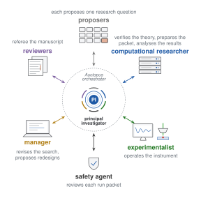

<p align="center">
  <picture>
    <source media="(prefers-color-scheme: dark)" srcset="docs/assets/auctopus-logo-dark.svg">
    
  </picture>
</p>

<p align="center">
  <a href="https://github.com/E-zClap/auctopus/actions/workflows/tests.yml"></a>
  <a href="LICENSE"></a>
  
</p>

Auctopus is an open-source Python package and command-line tool that orchestrates AI agents for experimental research. It is for researchers connecting agents to their instrument and computational host, and developers building research agents. You supply prompts and a domain pack: Markdown descriptions of your system, its capabilities and operating rules. The workflow produces a manuscript, source files, reports and a decision journal.

In the study described in [The paper](docs/paper.md), agents derived a calibration law for quantum spins and revised an experiment after reference measurements revealed signal drift.

Version 1.0.0 is the first public release of the engine and templates. The study's prompts and instrument description are not included; the commands below do not reproduce the paper.

- **Reject and redirect:** a principal-investigator (PI) agent can reject whole proposal batches; the manager can revise the search or propose a redesigned test.
- **Design before acquisition:** a run packet is a folder containing the instrument protocol, raw-data requirements and analysis code. The code is tested on a digital twin that simulates the proposed test.
- **Inspect the decisions:** prompts, replies and a timestamped decision journal are saved in the run folder.

[Demo](#try-the-offline-demo) · [Getting started](docs/getting-started.md) · [Running](docs/running.md) · [Workflow](docs/workflow.md) · [The paper](docs/paper.md) · [Contributing](CONTRIBUTING.md)

## Try the offline demo

With Git and Python 3.11 or later available, run these commands. Use `python3` wherever `python` does not select Python 3.11 or later.

```bash
git clone https://github.com/E-zClap/auctopus.git
cd auctopus
python -m auctopus dry-run
```

The clone follows the default branch. After cloning, the demo runs offline using only the Python standard library. No API keys or SSH are needed, and you do not need to supply your own prompts. A first run of version 1.0.0 took about 10 seconds in a clean Python 3.12 environment. CI tests Python 3.11, 3.12 and 3.13 on Ubuntu and Windows.

The default demo succeeds when all eight stages show `done`, the command exits with code `0`, and `decisions-journal.md` exists in the printed run folder. Open that journal to follow the proposal rejection, revision and selection.

Mock models and coding agents exercise the workflow and file exchange; local folders replace the remote machines. The demo does not evaluate your prompts or operate an instrument. Human approval is skipped.

To exercise redesign, safety correction and an acquisition rerun with an amended packet:

```bash
python -m auctopus dry-run --scenario lab-redo
```

Excerpt from the `lab-redo` dry-run journal, captured on 31 October 2026 with mock models; earlier lines are omitted:

```text
- 2026-10-31T03:13:37 lab: RERUN-DECISION AMEND for acquisition 20261031-031334-dry-run-20261031-031336-run1
- 2026-10-31T03:13:37 lab: SAFETY APPROVE (review 3)
- 2026-10-31T03:13:37 lab: acquisition 20261031-031334-dry-run-20261031-031337-run2 returned status done
- 2026-10-31T03:13:40 deliver: delivery-v1 assembled (final paper: main.pdf)
```

See [Running](docs/running.md#run-the-offline-scenarios) for all scenarios and [Outputs](docs/outputs.md) for the files to inspect.

## How it works

<p align="center">
  <picture>
    <source media="(prefers-color-scheme: dark)" srcset="docs/assets/agents-dark.svg">
    
  </picture>
</p>

<p align="center"><em>Main research roles. Spokes represent tasks and documents routed between the PI and each role by the Auctopus orchestrator, the software that carries every document.</em></p>

The PI develops the theory and designs tests; the computational researcher checks the theory and prepares the packet; the experimentalist operates the instrument. After selecting a question, the PI continues that conversation; other roles use fresh conversations or agent sessions with saved files, notes and reports. See [Workflow](docs/workflow.md) for roles, information boundaries and stage decisions. `RUN-DONE.json` records workflow completion and delivery, not scientific success; [Running](docs/running.md#read-exit-codes-and-completion-markers) explains the completion rules.

## The research behind Auctopus

The study asked how many calibration measurements predict the response of an ensemble of nitrogen-vacancy (NV) centres in diamond to microwave pulse sequences. Let $L$ be the maximum number of pulses in the sequences to be predicted. The agents derived an exact law: when each spin's pulse errors persist through a sequence, $L^2 + 1$ calibration measurements are necessary and sufficient to predict the ensemble's response to every sequence of up to $L$ phase-controlled pulses. They checked the law computationally on a supercomputer.

The first experiment agreed with the predictions, but repeated reference measurements revealed signal drift. The agents treated the result as inconclusive and revised the measurement protocol without relaxing the acceptance criteria. The revised experiment met those criteria and supported the predictions.

Read [The paper](docs/paper.md) for the search history, experimental decisions, human contributions and comparison with this release.

## Run a real study

Choose a computational host: a high-performance computing (HPC) system or another Linux server. For the instrument computer, choose SSH or a manual exchange folder. Laboratory work, figures and the independent manuscript reviewer stage can each be switched off.

> [!WARNING]
> Remote coding agents run without interactive approvals by default. Use dedicated machines and accounts, and keep publishing credentials off them. Real runs use paid APIs and can last many hours. Read [Safety](docs/safety.md) for execution permissions and cost controls.

Follow [Getting started](docs/getting-started.md) to choose providers, machines and stages, create a project and prepare the remote agents. Write the prompts and domain files required by your configured stages. Start with proposal search alone, inspect the decisions, then resume through computational verification before continuing to the laboratory stage.

With the default laboratory settings, the packet receives PI review, safety-agent approval and human approval before it reaches the instrument. Follow [Running](docs/running.md#approve-or-decline-a-laboratory-design) when a run pauses for your decision.

## Documentation

The [documentation index](docs/README.md) gives reading orders for researchers, agent developers and paper readers.

| Task | Guide |
|---|---|
| Prepare a real project | [Getting started](docs/getting-started.md) |
| Understand roles, stages and decisions | [Workflow](docs/workflow.md) |
| Choose models and configure limits | [Configuration](docs/configuration.md) |
| Describe your system and write stage instructions | [Domain packs](docs/domain-packs.md) and [Prompts](docs/prompts.md) |
| Connect computational and instrument computers | [Remote agents](docs/remote-agents.md) |
| Monitor, approve or resume a run | [Running](docs/running.md) |
| Inspect decisions, raw data and deliveries | [Outputs](docs/outputs.md) |

## Contributing

For a quick check, run the tests offline with the Python standard library:

```bash
python -m unittest discover -s tests
```

Read [Contributing](CONTRIBUTING.md) for the code map, required checks and contribution guidance. See the [code of conduct](CODE_OF_CONDUCT.md), [security policy](SECURITY.md) and [changelog](CHANGELOG.md).

## Citation

The accompanying paper is **Collaborative AI agents for autonomous experimental research with solid-state quantum spins**, by El Mustapha Mansouri, Eikichi Kimura, Masato Koga and Keigo Arai.

```bibtex
@misc{mansouri2026collaborative,
  title = {Collaborative AI agents for autonomous experimental research with solid-state quantum spins},
  author = {Mansouri, El Mustapha and Kimura, Eikichi and Koga, Masato and Arai, Keigo},
  year = {2026},
  note = {arXiv preprint}
}
```

Citation metadata is also available in [CITATION.cff](CITATION.cff).

## Licence

Auctopus is available under the [MIT licence](LICENSE).
