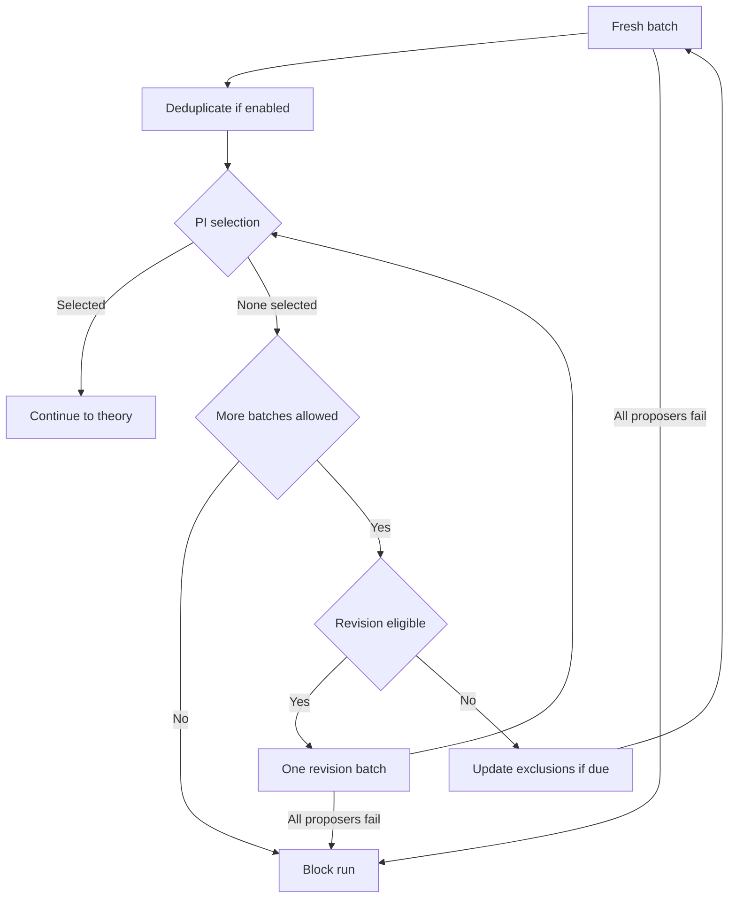
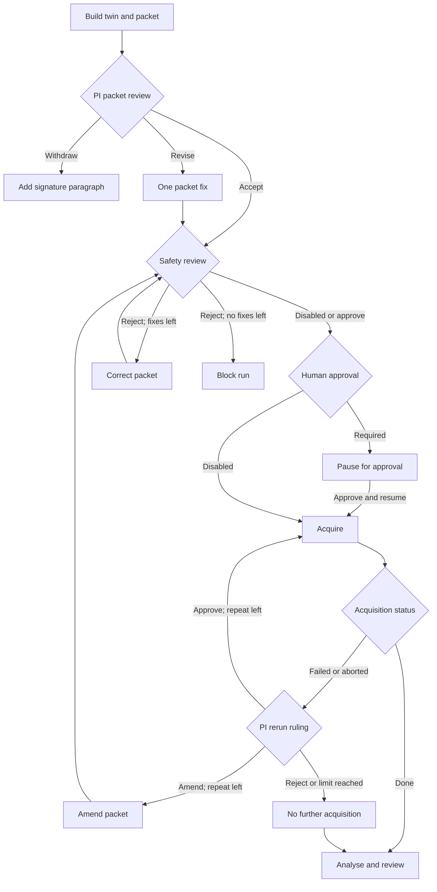

# Workflow

Auctopus's Python orchestrator routes research questions, manuscripts, test designs and results between agents. This page explains their roles, information boundaries and the eight stages. For commands, see [Running](running.md).

A **run** is one execution of the workflow. An **acquisition** is one execution of a run packet on the instrument; a run can contain several acquisitions.

## Roles and document routing

  <picture>
    <source media="(prefers-color-scheme: dark)" srcset="assets/agents-dark.svg">
    
  </picture>

<em>Spokes represent tasks and documents routed by Auctopus between the PI and each role. The dashed ring represents the orchestrator; spokes do not show execution order.</em>

The map shows the main research roles. Deduplication and feasibility review are supporting roles, not drawn here. The orchestrator supplies task inputs and carries documents between roles; agents do not message one another directly.

| Role | Work |
|---|---|
| Proposers | Each proposes one question without seeing the others' proposals. |
| Principal investigator (PI) | Selects a question, develops theory, writes the manuscript, designs tests, reviews results and rules on laboratory decisions. |
| Computational researcher | Verifies theory, prepares the digital twin and run packet, analyses results, revises the manuscript and renders figures. Uses Codex by default on an HPC or another Linux server. |
| Experimentalist | Executes the packet and returns data, logs and deviations. Uses Claude Code by default on the instrument computer over SSH; manual hand-off can use an agent or person. |
| Manager | Excludes recurring rejected idea families and proposes redesigned tests after the PI declines laboratory work. |
| Safety agent | Reviews packets against instrument specifications and laboratory rules when enabled. |
| Reviewers | Referee the manuscript. |
| Deduplication | Groups proposals sharing a central idea and keeps representatives. |
| Feasibility reviewer | Assesses whether and how the instrument can test the theory. |

## Information boundaries and memory

| Roles or tasks | Context supplied or retained |
|---|---|
| Proposers, deduplication and each batch's PI assessment | Each call starts a new conversation with only its supplied inputs. |
| Feasibility reviewer, manager, safety agent and manuscript reviewers | Each call starts a new conversation with only its supplied inputs. |
| PI after selection | The selecting batch's conversation continues for theory, laboratory triage and rulings, and every PI review. It retains the selection verdict, theory, manuscript and earlier reviews. |
| Computational researcher and experimentalist | Each task starts a fresh agent session. The working folder, `NOTES-RESUME.md` and earlier reports carry memory between tasks. |

The continuing PI conversation is saved in `conversations/pi.json`. Long histories are summarised when they exceed `project.max_history_chars`, default `900000` characters. The latest exchange stays verbatim; old turns are archived.

Prompts, replies and the `decisions-journal.md` decision record are saved in the run folder. See [Outputs](outputs.md) for its layout.

## How decisions advance the run

The engine reads the last matching decision line in a reply. A missing or unreadable `VERDICT:` requests revision. `LAB-WITHDRAW` is recognised anywhere in a packet review. [Prompts](prompts.md) specifies the reply contracts.

The PI review policy determines whether a correction is followed by another review:

| PI review | `chain.review_mode = "once"` (default) | `"until-accept"` | Acceptance required? |
|---|---|---|---|
| Computational verification | One review; at most one revision | Up to `chain.max_review_rounds` reviews, default `5` | Only in `until-accept` |
| Final manuscript after referee revisions | One review; at most one revision | Up to `chain.final_review_rounds` reviews, default `2` | Only in `until-accept` |
| Run packet | One review; at most one fix | Same | No |
| Laboratory analysis | One review; at most one fix | Same | No |
| Figure 1 | One review; at most one fix | Same | No |
| Remaining figures | One review; at most one fix | Same | No |

One-review policies continue after the correction without requiring later acceptance. In `until-accept`, verification and final manuscript review repeat until `VERDICT: ACCEPT`; exhausting their respective limits blocks the run. Safety review has its own correction limit and requires `SAFETY: APPROVE` when enabled.

## 1. Search for a question: `proposals`

Each fresh proposer receives a brief combining the prompt template, physical anchor and exclusions. The anchor contains the sample card and `proposer-rule.md`; exclusions combine the authored list and manager's additions. The brief is fixed at batch start in `batches/NN-fresh/prompt.md`.

By default, a batch has ten proposers and at most five requests in flight. Two separate thresholds govern replies:

| Check | Threshold | Effect |
|---|---|---|
| Early assessment | Five replies of at least 600 words each, by default | Cancel remaining requests and assess the batch. |
| Junk filter | Under 400 characters, or under 600 characters with an error phrase | Drop the reply. |

Replies below the word threshold still reach the PI if the junk filter retains them. When enabled, deduplication groups proposals by central idea in fresh batches with at least two replies. An unreadable `KEEP:` line retains all proposals.

The PI assesses each batch in a fresh conversation. Strict selection, the default, permits rejecting every proposal. From `proposals.relax_after`, default batch `12`, strict search switches to instructions to select and strengthen the strongest proposal. Setting `0` disables that switch; relaxed selection can also apply from the start.

`SELECTION: proposer-N` selects a proposal; `SELECTION: none` rejects the batch. Without a readable line, the reply counts as selection unless no-selection wording occurs in its first 1,200 characters.

A rejected fresh batch can supply `BEST SEED: proposer-N`. With revision enabled and another batch allowed, six revision proposers by default receive that seed verbatim, the whole batch's PI verdict and a brief without exclusions. A revision batch cannot be revised again.

If another batch is allowed, the search returns to fresh proposals after:

- A fresh rejection without a readable seed.
- A fresh rejection with revision disabled.
- A rejected revision batch.

By default, six consecutive batches without selection trigger a manager update before the next fresh batch. The counter resets after each update. `proposals.manager_exclusions_after` sets the threshold; `0` disables updates. The manager reads those verdicts and the current brief, then adds exclusions to `exclusions-manager.md` for later fresh batches.

Arrows show control-flow transitions between batches, assessments and outcomes. Revision is eligible only after a fresh batch with a readable seed, with revision enabled and another batch allowed.

Selection preserves that batch's PI conversation, copies its verdict to `pi-verdict.md` and records the batch in `selection.json`. The run blocks if every proposer in a batch fails, or no selection occurs within `proposals.max_batches`, default `24`.

## 2. Develop the theory: `theory`

The PI follows `chain.theory_steps`. By default, it develops proofs, compares the theory's claims with the closest prior research, writes the LaTeX manuscript and designs a computational test. Manuscript file blocks go into `package/`; the test design becomes `experiment.md`. If no `.tex` file arrives, the PI receives one request to redeliver it.

## 3. Run the computational test: `verify`

The orchestrator sends `package/` and `experiment.md` to a new working folder under `hpc.remote_root`. The computational researcher is instructed to run the test, keep LaTeX source and compiled PDF together, update `NOTES-RESUME.md` and finish with `ROUND-DONE.json`. This record contains status (`done` or `blocked`), summary and deliverables. Returned folders begin at `hpc-round1/`.

See [Configuration](configuration.md) for transfer limits and [Outputs](outputs.md) for omitted-file records. Computational task failures and orchestrator interruptions have separate recovery rules in [Running](running.md#when-the-orchestrator-or-a-remote-process-stops).

## 4. Review the computation: `verify-review`

The PI reviews the main PDF first, then source and reports. `chain.review_max_files` caps each PI review at nine attached files by default. `chain.review_max_mb` caps each message's attachments at 18 MB by default; excess files are skipped with a warning.

`VERDICT: ACCEPT` carries the numbered changes requested with acceptance into the next task. `VERDICT: REVISE`, or an unreadable verdict, requests revision. The review-policy table above determines when the workflow continues.

## 5. Design and run the laboratory test: `lab`

`chain.lab = false` skips this stage. It is enabled by default.

### Decide whether to test

The feasibility reviewer reads the manuscript, `instrument.md` and sample card. Its `FEASIBILITY:` line is recorded in the journal, including unreadable outcomes. The PI decides with `LAB-DECISION: GO` or `LAB-DECISION: NO-GO`; an unreadable decision declines the test.

After a negative decision, `chain.manager_redesign`, enabled by default, gives the manager one opportunity to propose a test separating the theory's prediction from rivals. The PI rules once on that redesign.

### Build and review the packet

For an authorised test, the computational researcher receives `hardware/instrument.md` and builds the digital twin and `lab_packet/`. The packet contains `README.md`, numbered steps in `protocol.md`, raw-data requirements in `results_schema.md`, `analysis/` code tested on twin data, and `twin/` with its report.

The PI reviews the packet once and can request one fix. `LAB-WITHDRAW` in that review withdraws the test.

After a final `LAB-DECISION: NO-GO` or `LAB-WITHDRAW`, the PI specifies an **experimental-signature paragraph**. The computational researcher adds it to the manuscript in place of the laboratory test. It describes an observable prediction by which a later experiment could test the theory; no acquisition takes place.

Arrows show progression to acquisition, correction or analysis after the PI authorises a test. Safety review and human approval each have a configurable bypass. An unchanged repeat reuses existing approvals; an amendment returns through enabled checks.

### Apply the configured approvals

With `lab.safety_review = true`, the safety agent reads the packet README, protocol and schema, `instrument.md` and `lab-safety.md`. Only `SAFETY: APPROVE` approves the packet. Any other outcome sends corrections to the computational researcher, followed by another safety review. Rejection after `lab.safety_fix_rounds` corrections, default `1`, blocks the run before hand-off.

With `lab.require_approval = true`, Auctopus writes `LAB-APPROVAL-REQUIRED.md` and exits with code `2`. A person reads the packet and any safety review, then approves and resumes the run. Both settings default to `true`. See [Running](running.md#approve-or-decline-a-laboratory-design) for approval and decline commands, and [Safety](safety.md) for responsibilities.

### Acquire, decide on repeats and analyse

The packet version sent for an acquisition is recorded in `RUN-REQUEST.json` with each file's SHA-256 hash. Packets enter `inbox/<run-id>/`; results return through `outbox/<run-id>/`. Here, `<run-id>` identifies one acquisition. The experimentalist returns `RUN-RESULT.json`, raw files in `data/` and `deviations.md`. Status is `done`, `aborted` or `failed`.

SSH transport appends laboratory safety rules to the experimentalist's instructions and pulls results into `lab_results/<run-id>/`, subject to `lab.max_pull_mb`. Manual transport uses a local exchange folder; give its person or agent the safety rules separately.

For an acquisition that does not finish with `done`, the PI agent rules through `RERUN-DECISION`:

- `APPROVE` repeats the unchanged packet without a new safety review or human approval; any existing approvals stand.
- `AMEND` asks the computational researcher to change the packet, then repeats enabled safety and human checks.
- `REJECT`, including an unreadable decision, permits no further acquisition.

`chain.lab_reruns` permits one repeat by default. Exhausting it also prevents further acquisition. Infrastructure never relaunches an acquisition: SSH retries reconnect, and resume waits for an existing job or collects its result. Only the PI agent's ruling authorises a repeat.

When further acquisition is rejected or the allowance is exhausted, analysis still proceeds. The computational researcher analyses the last acquisition's returned `RUN-RESULT.json`, data and deviations. The PI reviews that analysis once, with at most one fix in either review mode.

## 6. Build and review figures: `figures`

With `chain.figures = true`, the default, the PI plans the key figure. The computational researcher builds Figure 1 and its page preview. The PI reviews Figure 1 alone; its `FIGURE:` decision accepts it or requests one fix.

The researcher next renders every remaining figure, excluding Figure 1, with its page preview. The PI reviews this set with `FIGURES:` and can request one fix. Missing or unreadable decisions also request a fix.

Both reviews attach rendered figures and page previews within the per-review `chain.review_max_files` cap, default nine files. No full manuscript or source is attached. The PI retains its earlier conversation, including the manuscript and previous reviews. `chain.figures = false` skips this stage.

## 7. Obtain manuscript reviews: `reviewers`

Each role in `chain.reviewers` receives the manuscript PDF and its main LaTeX source file in a fresh conversation. Reviewers receive no analysis code, data or earlier exchanges. The default list contains one Claude reviewer and one GPT reviewer; an empty list skips the stage.

The PI triages their referee reports into a revision brief, the computational researcher applies it, and the PI performs final review under the policy above.

## 8. Assemble the delivery: `deliver`

The orchestrator copies the final paper, source, reports and figures from the latest round into `delivery-vN/` and writes `MANIFEST.sha256` checksums. `RUN-DONE.json` records workflow completion and delivery, not scientific success. A run can complete without a laboratory test or without acceptance after its permitted correction. Assess the scientific outcome from the manuscript, evidence and decision journal.

A blocked run writes `RUN-BLOCKED.md` and exits with code `1`. See [Running](running.md) for stage limits, recovery and stopping, [Domain packs](domain-packs.md) for the system description, and [Prompts](prompts.md) for research instructions.
